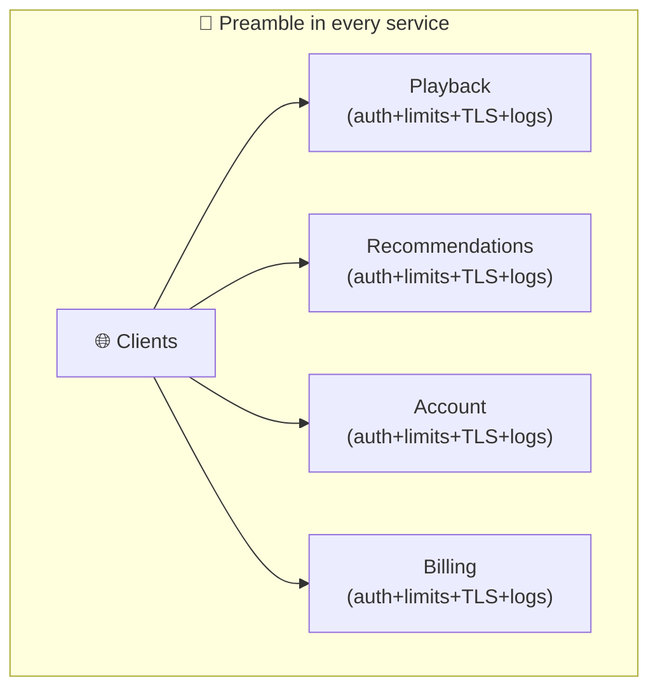

# API Gateways

> **Phase:** APIs & Communication Deep Dives → **Topic:** 11 of 15 → **Read time:** ~48 minutes

---

## Before You Begin

**This document stands alone.** It assumes you have read nothing else — not the foundation series, not the topics before it. It builds the API gateway from zero: why a fleet of services behind a public boundary all need the same handful of things done to every request, why those things want one home rather than a copy in each service, and — the part that matters most — why concentrating them into a single front door is at once the gateway's whole value and its whole danger.

Two consequences of that choice:

- **Terms get defined where they're used** — API gateway, routing, cross-cutting concern, TLS termination, protocol translation, aggregation, Backend-for-Frontend. Skim what you know.
- **Neighbouring topics are named, not taught.** A gateway *performs* jobs that are subjects in their own right — rate limiting, authentication, the reverse proxy it's built on, the load balancer it's often confused with, the gRPC it may translate to. Where this document reaches them, it points rather than teaches, so it can stay on what's genuinely the gateway's own.

The API gateway sits alongside the **Top 30 Must-Know Concepts** foundation series as the piece of infrastructure that makes a fleet of services usable from the outside. This is the deep-dive on what it is and what it costs.

Here is the question the document answers:

> **Behind a public API there is rarely one program — there's a fleet of services, each of which would otherwise have to authenticate callers, enforce limits, terminate encryption, and log traffic before doing any real work. Where should all that shared work live, who should the outside world actually talk to — and why does putting it all in one place solve the problem and create a new one in the same move?**

Here's the trap it disarms. A gateway gets filed as "a reverse proxy with a fancier name" — a box that forwards requests to the right server, nothing more. That framing misses what makes it a gateway. A plain reverse proxy forwards by *position* — this host, that path — and doesn't care what the request means. A gateway reads all the way up to the *API*: who the caller is, which quota they fall under, which several services a single request should fan out across, how to reshape the answer. It's not a smarter router; it's the tier where the public contract is deliberately held apart from the internal fleet, and where everything true of *every* request gets done once.

> **The mindset shift:** stop picturing a gateway as *a router sitting in front of your services* and start picturing it as **the boundary tier that owns everything true of every request** — identity, limits, encryption, observability, shaping, routing — so that no service behind it re-implements any of it. Hold that and the gateway's power and its peril turn out to be a single fact: a door that owns everything is a door everything depends on. Centralizing the shared work is exactly why the services behind it stay simple and consistent — and exactly why that one door is a chokepoint, a bottleneck, and a magnet for logic that was never supposed to live there. Learn to see the one door as both the answer and the risk, and the rest of this document is the two sides of that coin.

---

## Table of Contents

1. [The Problem — Concerns With No Home](#1-the-problem--concerns-with-no-home)
2. [The Gateway Is the One Front Door](#2-the-gateway-is-the-one-front-door)
3. [Routing — Getting a Request to the Right Service](#3-routing--getting-a-request-to-the-right-service)
4. [The Cross-Cutting Jobs — Done Once, at the Door](#4-the-cross-cutting-jobs--done-once-at-the-door)
5. [Translation — Decoupling the Public Contract from the Inside](#5-translation--decoupling-the-public-contract-from-the-inside)
6. [Aggregation and the Backend-for-Frontend](#6-aggregation-and-the-backend-for-frontend)
7. [The Cost — One Door Is a Chokepoint](#7-the-cost--one-door-is-a-chokepoint)
8. [When the Gateway Becomes a Monolith](#8-when-the-gateway-becomes-a-monolith)
9. [When You Need One — and When You Don't](#9-when-you-need-one--and-when-you-dont)
10. [Putting It All Together — A Streaming App's Mobile Edge](#10-putting-it-all-together--a-streaming-apps-mobile-edge)
11. [Final Recap](#11-final-recap)

---

## 1. The Problem — Concerns With No Home

Before a gateway is a solution, there's a problem that makes it inevitable, and it appears the moment a system grows from one program into several. The problem isn't the services themselves — it's the pile of *shared work* that surrounds every one of them and belongs to none.

### Every Service Repeats the Same Preamble

Picture a system split into services — a playback service, a recommendations service, an account service, a billing service — each exposed so the outside world can reach it. Now look at what each one must do *before* it gets to its actual job. On every incoming request, every service has to:

- Establish who the caller is and whether they're allowed in.
- Check that this caller hasn't exceeded how much they're permitted to use.
- Handle the encryption the public internet requires.
- Record the request for metrics, tracing, and debugging.
- Deal with the browser rules (like cross-origin permissions) that any public endpoint faces.

Only *after* all of that does the service do the thing it actually exists to do. That preamble is identical across every service, and it has a nasty property: it isn't really *about* any of them. Playback doesn't want to be in the identity business; recommendations doesn't want to own encryption. These are **cross-cutting concerns** — work that applies uniformly to every request across the whole system, orthogonal to what any single service does.

### Putting the Preamble in Each Service Goes Wrong Two Ways

The naive answer is to have every service handle its own preamble. It fails on two fronts at once.

- **Duplication that drifts.** The same identity-checking and limit-enforcing logic is now copied into a dozen services, in however many languages and frameworks they happen to use. That's a maintenance burden, but the real danger is *drift*: fix an authentication flaw in one service and the other eleven still have it; tighten a limit in one and the rest disagree. Cross-cutting logic that lives in many places is cross-cutting logic that's inconsistent by default, and inconsistency at the security boundary is exactly where you can least afford it.
- **A dozen doors to defend.** If every service is directly reachable from the internet, every service is an attack surface, each must be hardened, each needs its own public exposure. There is no single place to enforce a rule, observe traffic, or shut off abuse — the boundary is smeared across the whole fleet, so there's nowhere to *stand* and control it.

### The Shape of the Answer

State the problem precisely and its solution is already implied: there is a body of work that (a) must happen on *every* request, (b) should be *identical* everywhere, and (c) needs a single place to be enforced and observed. Scattering it across services violates all three. So it wants to be **lifted out** of the services entirely and done in *one place that every request passes through first* — a place where the rule is written once, applied uniformly, and where there's a single point to watch and control. That one place is the API gateway, and the next section is what it is.

> 💡 **Key Insight**
>
> A fleet of services behind a public boundary shares a large preamble — establishing identity, checking limits, handling encryption, logging, browser rules — that runs on **every** request but belongs to **no** service. These **cross-cutting concerns** go wrong in two ways when each service handles its own: the logic is **duplicated and drifts** out of consistency (a fix in one leaves the others vulnerable), and every service becomes a **separately-exposed door** with no single place to enforce or observe anything. Work that must run everywhere, stay identical, and have one control point wants to be **lifted into one place every request passes through first** — which is precisely the gateway.

### Quick Recap — Concerns With No Home

- Behind a public boundary, every service repeats the same **preamble** — identity, limits, encryption, logging, browser rules — before doing its real work.
- These are **cross-cutting concerns**: work that runs on every request uniformly and is orthogonal to what any single service actually does.
- Handling them per-service fails twice: the logic **duplicates and drifts** (a fix in one service leaves the rest exposed), and every service becomes its **own public door** with no single control point.
- Work that must run everywhere, stay identical, and be enforced in one place wants to be **lifted into a single entry point** every request passes through first — the gateway.

---
