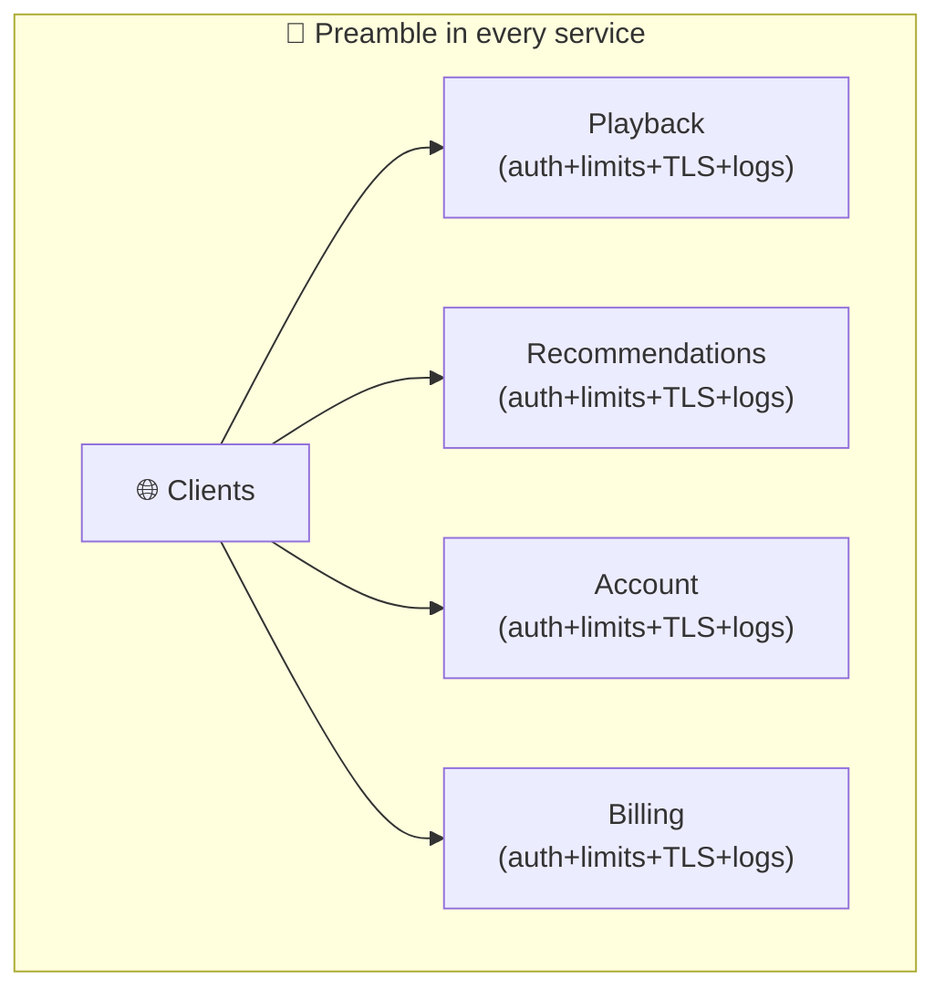
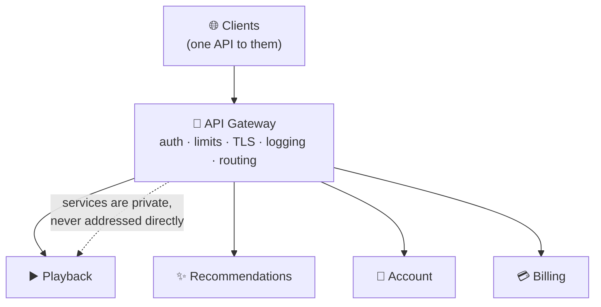
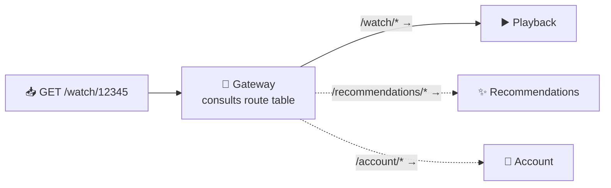
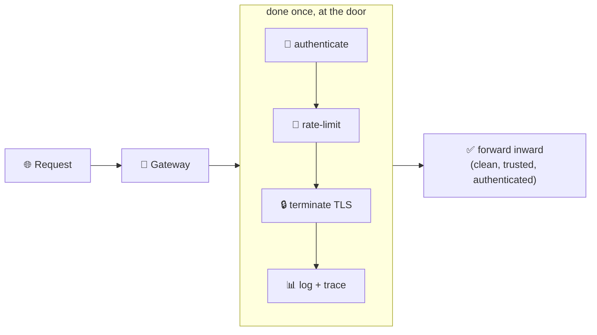
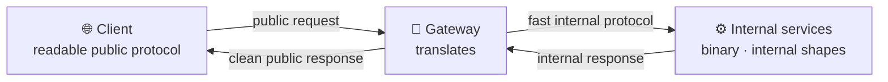
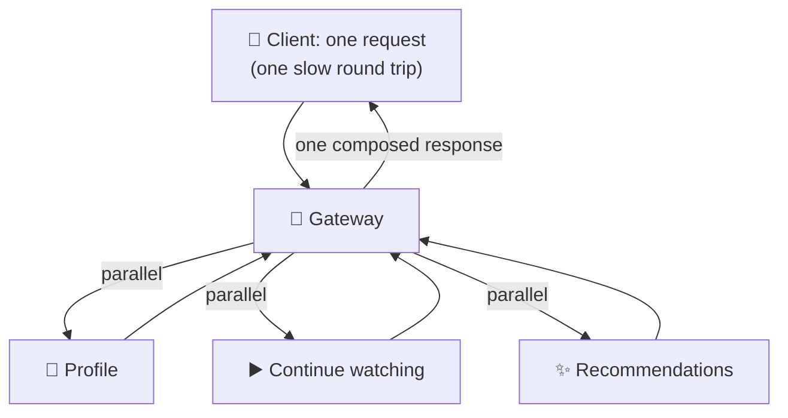
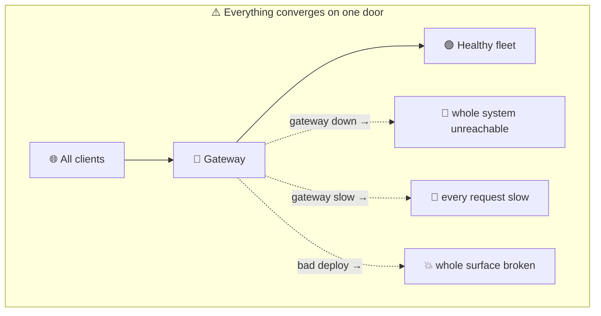

# API Gateways

> **Phase:** APIs & Communication Deep Dives → **Topic:** 11 of 15 → **Read time:** ~48 minutes

---

## Before You Begin

**This document stands alone.** It assumes you have read nothing else — not the foundation series, not the topics before it. It builds the API gateway from zero: why a fleet of services behind a public boundary all need the same handful of things done to every request, why those things want one home rather than a copy in each service, and — the part that matters most — why concentrating them into a single front door is at once the gateway's whole value and its whole danger.

Two consequences of that choice:

- **Terms get defined where they're used** — API gateway, routing, cross-cutting concern, TLS termination, protocol translation, aggregation, Backend-for-Frontend. Skim what you know.
- **Neighbouring topics are named, not taught.** A gateway *performs* jobs that are subjects in their own right — rate limiting, authentication, the reverse proxy it's built on, the load balancer it's often confused with, the gRPC it may translate to. Where this document reaches them, it points rather than teaches, so it can stay on what's genuinely the gateway's own.

The API gateway sits alongside the **Top 30 Must-Know Concepts** foundation series as the piece of infrastructure that makes a fleet of services usable from the outside. This is the deep-dive on what it is and what it costs.

Here is the question the document answers:

> **Behind a public API there is rarely one program — there's a fleet of services, each of which would otherwise have to authenticate callers, enforce limits, terminate encryption, and log traffic before doing any real work. Where should all that shared work live, who should the outside world actually talk to — and why does putting it all in one place solve the problem and create a new one in the same move?**

Here's the trap it disarms. A gateway gets filed as "a reverse proxy with a fancier name" — a box that forwards requests to the right server, nothing more. That framing misses what makes it a gateway. A plain reverse proxy forwards by *position* — this host, that path — and doesn't care what the request means. A gateway reads all the way up to the *API*: who the caller is, which quota they fall under, which several services a single request should fan out across, how to reshape the answer. It's not a smarter router; it's the tier where the public contract is deliberately held apart from the internal fleet, and where everything true of *every* request gets done once.

> **The mindset shift:** stop picturing a gateway as *a router sitting in front of your services* and start picturing it as **the boundary tier that owns everything true of every request** — identity, limits, encryption, observability, shaping, routing — so that no service behind it re-implements any of it. Hold that and the gateway's power and its peril turn out to be a single fact: a door that owns everything is a door everything depends on. Centralizing the shared work is exactly why the services behind it stay simple and consistent — and exactly why that one door is a chokepoint, a bottleneck, and a magnet for logic that was never supposed to live there. Learn to see the one door as both the answer and the risk, and the rest of this document is the two sides of that coin.

---

## Table of Contents

1. [The Problem — Concerns With No Home](#1-the-problem--concerns-with-no-home)
2. [The Gateway Is the One Front Door](#2-the-gateway-is-the-one-front-door)
3. [Routing — Getting a Request to the Right Service](#3-routing--getting-a-request-to-the-right-service)
4. [The Cross-Cutting Jobs — Done Once, at the Door](#4-the-cross-cutting-jobs--done-once-at-the-door)
5. [Translation — Decoupling the Public Contract from the Inside](#5-translation--decoupling-the-public-contract-from-the-inside)
6. [Aggregation and the Backend-for-Frontend](#6-aggregation-and-the-backend-for-frontend)
7. [The Cost — One Door Is a Chokepoint](#7-the-cost--one-door-is-a-chokepoint)
8. [When the Gateway Becomes a Monolith](#8-when-the-gateway-becomes-a-monolith)
9. [When You Need One — and When You Don't](#9-when-you-need-one--and-when-you-dont)
10. [Putting It All Together — A Streaming App's Mobile Edge](#10-putting-it-all-together--a-streaming-apps-mobile-edge)
11. [Final Recap](#11-final-recap)

---

## 1. The Problem — Concerns With No Home

Before a gateway is a solution, there's a problem that makes it inevitable, and it appears the moment a system grows from one program into several. The problem isn't the services themselves — it's the pile of *shared work* that surrounds every one of them and belongs to none.

### Every Service Repeats the Same Preamble

Picture a system split into services — a playback service, a recommendations service, an account service, a billing service — each exposed so the outside world can reach it. Now look at what each one must do *before* it gets to its actual job. On every incoming request, every service has to:

- Establish who the caller is and whether they're allowed in.
- Check that this caller hasn't exceeded how much they're permitted to use.
- Handle the encryption the public internet requires.
- Record the request for metrics, tracing, and debugging.
- Deal with the browser rules (like cross-origin permissions) that any public endpoint faces.

Only *after* all of that does the service do the thing it actually exists to do. That preamble is identical across every service, and it has a nasty property: it isn't really *about* any of them. Playback doesn't want to be in the identity business; recommendations doesn't want to own encryption. These are **cross-cutting concerns** — work that applies uniformly to every request across the whole system, orthogonal to what any single service does.

### Putting the Preamble in Each Service Goes Wrong Two Ways

The naive answer is to have every service handle its own preamble. It fails on two fronts at once.

- **Duplication that drifts.** The same identity-checking and limit-enforcing logic is now copied into a dozen services, in however many languages and frameworks they happen to use. That's a maintenance burden, but the real danger is *drift*: fix an authentication flaw in one service and the other eleven still have it; tighten a limit in one and the rest disagree. Cross-cutting logic that lives in many places is cross-cutting logic that's inconsistent by default, and inconsistency at the security boundary is exactly where you can least afford it.
- **A dozen doors to defend.** If every service is directly reachable from the internet, every service is an attack surface, each must be hardened, each needs its own public exposure. There is no single place to enforce a rule, observe traffic, or shut off abuse — the boundary is smeared across the whole fleet, so there's nowhere to *stand* and control it.



### The Shape of the Answer

State the problem precisely and its solution is already implied: there is a body of work that (a) must happen on *every* request, (b) should be *identical* everywhere, and (c) needs a single place to be enforced and observed. Scattering it across services violates all three. So it wants to be **lifted out** of the services entirely and done in *one place that every request passes through first* — a place where the rule is written once, applied uniformly, and where there's a single point to watch and control. That one place is the API gateway, and the next section is what it is.

> 💡 **Key Insight**
>
> A fleet of services behind a public boundary shares a large preamble — establishing identity, checking limits, handling encryption, logging, browser rules — that runs on **every** request but belongs to **no** service. These **cross-cutting concerns** go wrong in two ways when each service handles its own: the logic is **duplicated and drifts** out of consistency (a fix in one leaves the others vulnerable), and every service becomes a **separately-exposed door** with no single place to enforce or observe anything. Work that must run everywhere, stay identical, and have one control point wants to be **lifted into one place every request passes through first** — which is precisely the gateway.

### Quick Recap — Concerns With No Home

- Behind a public boundary, every service repeats the same **preamble** — identity, limits, encryption, logging, browser rules — before doing its real work.
- These are **cross-cutting concerns**: work that runs on every request uniformly and is orthogonal to what any single service actually does.
- Handling them per-service fails twice: the logic **duplicates and drifts** (a fix in one service leaves the rest exposed), and every service becomes its **own public door** with no single control point.
- Work that must run everywhere, stay identical, and be enforced in one place wants to be **lifted into a single entry point** every request passes through first — the gateway.

---

## 2. The Gateway Is the One Front Door

The problem in §1 asked for a single place that every request passes through, where shared work is done once and the fleet is controlled from one spot. Give that place a name and a job description and you have the API gateway.

### The Definition

An **API gateway** is a single, application-aware entry point that all external requests pass through on their way to a fleet of internal services. To the outside world it *is* the API — one address, one surface — while behind it the request is served by whichever of many services is responsible. The clients never address those services directly; they only ever talk to the gateway, which stands between the public internet and a private internal network.

Two words in that definition carry the weight. **Single**: there is one door, so the shared work of §1 has exactly one home and the boundary has exactly one place to be enforced. **Application-aware**: the gateway doesn't just pass bytes along — it understands the request as an *API call* and acts on that understanding.



### Not Just a Reverse Proxy

There is a simpler, older idea a gateway resembles: a **reverse proxy** — an intermediary that holds the public address and forwards incoming requests to servers hidden behind it, so the internal machines are never reached directly. A gateway *is* built on that foundation; everything a reverse proxy gives — hiding the fleet, one public address, a single choke point for traffic — a gateway inherits. (The reverse proxy is a networking subject of its own; here it's named as the substrate, not re-explained.)

What makes it a *gateway* rather than *just* a reverse proxy is how deep it reads. A plain reverse proxy forwards by **position** — this hostname, that path prefix — and is largely indifferent to what the request actually is. A gateway reads up to the **application layer**: it interprets the request as a specific API call, and acts on its meaning — *who* is calling (identity), *how much* they may call (limits), *which* combination of services should serve it, *what shape* the answer should take. The reverse proxy answers "where do I forward this?"; the gateway answers "what should happen to this API call, from the moment it arrives to the moment it leaves?"

| | Plain reverse proxy | API gateway |
|---|---|---|
| Reads up to | Host / path (position) | The full API call (meaning) |
| Decides | Which server to forward to | Identity, limits, routing, shaping, aggregation |
| Knows the caller? | Not really | Yes — authenticates and applies per-caller policy |
| Fan-out / compose? | No | Yes — one request → several services → one response |

### Why "One Door" Is the Whole Idea

Everything the rest of this document covers — routing, the cross-cutting jobs, translation, aggregation — is something the gateway can do *because* it's the single application-aware door. Being single is what lets it be the one home for shared work and the one control point. Being application-aware is what lets that work be meaningful — you can't enforce a per-user limit if you can't tell who the user is, and you can't fan a request across services if you don't understand the request. Hold onto "single" and "application-aware" together: they're the two properties every later capability, and every later cost, descends from.

> 💡 **Key Insight**
>
> An **API gateway** is a **single, application-aware** entry point that every external request passes through to reach a private fleet — to clients it *is* the API. It's built on the reverse proxy (one public address, the fleet hidden behind it) but goes further: a reverse proxy forwards by **position** (host, path) and doesn't care what a request means, while a gateway reads up to the **API layer** and acts on the request's *meaning* — who's calling, their quota, which services serve it, what shape to return. "Single" gives the shared work one home and one control point; "application-aware" makes that work meaningful. Every capability and every cost ahead descends from those two properties.

### Quick Recap — The One Front Door

- An **API gateway** is a **single, application-aware** entry point all external requests pass through to reach a fleet of private internal services — to clients, it *is* the API.
- It's built on the **reverse proxy** (holds the public address, hides the fleet) but is more: a proxy forwards by **position**, a gateway acts on the request's **meaning**.
- Application-awareness is what lets it authenticate the caller, apply per-caller policy, route by API, and compose responses — things a position-only forwarder can't do.
- **"Single" and "application-aware"** are the two load-bearing properties: every later capability *and* every later cost descends from them.

---

## 3. Routing — Getting a Request to the Right Service

Start with the gateway's most basic job, the one it can't skip: since clients only ever talk to the gateway, the gateway has to figure out *which* internal service should actually handle each request. That's **routing**, and while it sounds mundane, it quietly buys one of the gateway's most valuable properties.

### Matching a Request to a Service

Every request arrives with attributes the gateway can read — its path, its host, its method, its headers. Routing is the rule that maps those attributes to an upstream service:

```
GET  /watch/12345        → playback service
GET  /recommendations    → recommendations service
GET  /account/profile    → account service
POST /billing/charge     → billing service
```

The gateway holds a **route table** (a service map) — the set of these rules — and consults it on every request to pick the destination, then forwards the request there and relays the response back. Most routing is by path prefix, as above, but a gateway can route on anything it can read: the host (for multiple public domains sharing one gateway), a header, an API version, even the identity it just established. Because it's application-aware (§2), the routing rule can be as expressive as the request is.



### The Payoff: The Public Shape Is Decoupled from the Inside

Here's what routing quietly earns, and it's bigger than "requests reach the right place." Because clients address the *gateway's* URL structure and the gateway translates that to internal destinations, **the public API's shape is decoupled from the internal service topology.** The two can now change independently:

- **Split a service in two** — carve the account service into `profile` and `preferences` — and clients notice nothing; you just update the route table so the old paths now point at the new services.
- **Merge or rename services** internally without touching a single client.
- **Move a service** to a new address, a new language, a new team — the route entry changes, the public URL doesn't.

The public URL becomes a *stable contract* while the internal arrangement stays free to evolve. Without a gateway, clients would hold addresses of specific services, and every internal reorganization would be a breaking change forced on everyone who calls you. The route table is the seam that absorbs internal change so the outside never feels it.

### Finding the Upstreams

One practical note, named not taught: in a real system the services behind the gateway move around — instances come and go, scale up and down, change addresses. So the gateway usually doesn't hold hard-coded addresses; it works with a **service discovery** mechanism that tells it where the live instances of each service currently are. How discovery works is a subject of its own in a later phase; here it's enough to know the route table maps to *services*, and something keeps the service-to-address lookup current underneath.

> 💡 **Key Insight**
>
> Routing is the gateway's floor: since clients only reach the gateway, it consults a **route table** that maps each request's attributes (path, host, version, even identity) to the right internal service, then forwards and relays. The quiet payoff is bigger than delivery — because clients address the gateway's URLs and it translates to internal destinations, the **public API shape is decoupled from the internal topology**, so you can split, merge, rename, or relocate services with only a route-table change and clients notice nothing. The stable public URL becomes a contract while the inside stays free to evolve; service discovery keeps the service-to-address lookup current underneath.

### Quick Recap — Routing

- **Routing** maps each request's attributes (path, host, method, version, identity) to the correct internal service via a **route table** the gateway consults on every request.
- Because the gateway is application-aware, routing rules can be as expressive as the request — path prefixes are common, but host, header, version, or caller all work.
- The payoff is **decoupling**: clients address the gateway's stable URLs, so services can be split, merged, renamed, or moved with only a route-table change and **no client impact**.
- The gateway typically finds live instances via **service discovery** (a later topic), so the route table maps to *services* while addresses stay current underneath.

---

## 4. The Cross-Cutting Jobs — Done Once, at the Door

Routing gets a request to the right place; this section is what the gateway does *to* every request on the way. These are the cross-cutting concerns from §1 — the shared preamble — now given their home. Each is done once, at the door, so no service behind it repeats the work and none can drift out of step. This is the gateway's central reason to exist.

### Guarding the Door: Identity and Limits

Two jobs run before a request is allowed to touch anything internal:

- **Authentication** — establishing *who* the caller is. The gateway inspects the request's credentials (a token, a key) and confirms the caller's identity before forwarding anything inward. A request that fails is rejected at the door — it never reaches a service at all. Because this happens once, centrally, the internal services can often trust that anything reaching them has already been authenticated, and receive the verified identity from the gateway rather than re-checking credentials themselves. (How identity is actually proven — tokens, signatures, the protocols involved — is a security subject of its own; the gateway is *where* it's enforced.)
- **Rate limiting** — enforcing *how much* a caller may use. The gateway counts each caller's requests and rejects those that exceed their allowance, protecting the whole fleet behind it from a single runaway or malicious client consuming capacity meant for everyone. Doing this at the door means one buggy client is stopped before it can touch a single service. (The algorithms that actually count and decide are the very next topic; here the point is *where* the limit is applied — at the one place all traffic converges.)

Both share a logic: they are decisions about *whether a request should proceed at all*, and the cheapest, safest place to make that decision is before the request enters the system — at the single door.

### Handling the Boundary: Encryption, Logging, Browser Rules

Three more jobs are about the mechanics of being a public boundary:

- **TLS termination** — the public internet requires encrypted connections, and the cryptographic work of setting them up and decrypting traffic is real cost. The gateway **terminates** that encryption at the edge: it handles the encrypted connection with the outside world, then forwards plain requests to services inside the trusted private network. Every service is spared the crypto machinery, and certificates live in one place instead of being managed on every service.
- **Logging, metrics, and tracing** — because every request flows through the gateway, it's the natural place to record traffic: what was called, by whom, how long it took, what came back. One consistent stream of observability for the entire surface, rather than each service logging in its own format. It's also where a **correlation id** can be stamped on each request so it can be followed as it fans out across services.
- **Browser rules (CORS and friends)** — the permission rules browsers enforce for cross-origin calls are the same for every endpoint, so they're handled once at the gateway rather than configured identically in each service.



### Why Centralizing These Is the Win

Notice what each service behind the gateway no longer has to do: no credential-checking, no limit-counting, no TLS, no bespoke logging, no CORS configuration. A service receives a request that has already been authenticated, permitted, decrypted, and logged, and can get straight to its actual job. That's the §1 problem solved on all three counts at once — the shared work runs on *every* request (it's in the one path all requests take), stays *identical* everywhere (there's only one copy), and has a *single control point* (change the rule at the gateway and it's changed for the whole system instantly). A new security rule is one gateway change, not a dozen coordinated service releases.

> 💡 **Key Insight**
>
> The cross-cutting jobs are the gateway's reason to exist: **authentication** and **rate limiting** decide *whether a request proceeds at all* and so belong before it enters the system; **TLS termination**, **logging/metrics/tracing**, and **browser rules** are boundary mechanics every endpoint would otherwise repeat. Doing all of them **once, at the door** means services behind it receive already-authenticated, permitted, decrypted, logged requests and get straight to their real work — and it solves §1 completely: the shared work runs everywhere (one path), stays identical (one copy), and has one control point (one change updates the whole system). The gateway performs these jobs; their deep mechanisms — how identity is proven, how limits are counted — are their own topics.

### Quick Recap — The Cross-Cutting Jobs

- **Authentication** and **rate limiting** run before a request reaches any service — deciding *whether it proceeds* — so a failed or abusive caller is stopped at the door, never touching the fleet.
- **TLS termination**, **logging/metrics/tracing**, and **browser rules (CORS)** are boundary mechanics the gateway handles once, sparing every service the crypto, bespoke logging, and repeated config.
- Services behind the gateway receive **already-authenticated, permitted, decrypted, logged** requests and get straight to their real job.
- Centralizing solves §1 on all three counts — the work runs **everywhere** (one path), stays **identical** (one copy), and has **one control point** (one change updates the whole system).

---

## 5. Translation — Decoupling the Public Contract from the Inside

Routing (§3) decoupled the public *URLs* from the internal topology. Translation goes further: the gateway can also decouple the public *protocol and shape* from whatever the internal services actually speak. This turns the gateway into a membrane between two worlds that no longer have to match.

### The Two Worlds Want Different Things

The world outside your system and the world inside it have opposite priorities, and a good architecture lets each optimize for its own.

- The **outside** wants a stable, universal, readable interface: ordinary web protocols any client can speak, a contract that doesn't break when internal code changes, formats that are easy to consume from a browser or a partner's backend.
- The **inside** wants speed and its own conventions: services may talk to each other over a compact binary protocol built for fast internal calls, use internal field names and shapes tuned for their own logic, and change freely as teams iterate.

If clients talked to services directly, these priorities would collide — the internal protocol would leak to the public, and every internal change would risk breaking external callers. The gateway resolves the collision by **translating** between the two.

### What the Gateway Translates

- **Protocol.** A gateway commonly accepts public requests over ordinary web protocols (the readable, universal ones any client can speak) and forwards them to internal services over whatever those services use — often a compact binary protocol chosen for internal speed (a pattern named where gRPC was discussed). The client gets universality; the internal call gets efficiency; neither compromises for the other.
- **Version.** The gateway can present a stable public version even as the internals move on. A request to an older public version of the API is mapped, at the gateway, onto the current internal services — so old clients keep working while the inside advances. (How a contract is versioned over time is its own topic; the gateway is one place that mapping can live.)
- **Shape.** Internal responses often carry more, or differently-named, fields than a public client should see. The gateway can reshape the response — drop internal-only fields, rename, restructure — so the public contract stays clean and intentional rather than being a leak of internal data structures.



### The Insulation This Buys

The deep value is **insulation**: the public contract and the internal implementation are held apart, free to change on their own schedules. Internal teams can switch protocols, rename fields, restructure services, or re-tune for performance without breaking a single external caller, because the gateway absorbs the difference. And the public API can present a deliberate, curated face — stable, clean, versioned — rather than exposing whatever the services happen to look like internally today. The gateway becomes the boundary where "how we present ourselves to the world" is defined independently of "how we're built inside." That independence is one of the strongest reasons to have a gateway at all — but note that every translation is also *logic living in the gateway*, a thread we pick up when the costs arrive (§8).

> 💡 **Key Insight**
>
> The outside world and the inside want opposite things — the outside wants a stable, universal, readable contract; the inside wants speed and freedom to change — and the gateway resolves the clash by **translating** between them: protocol (readable public ↔ fast internal binary), version (a stable public version mapped onto current internals), and shape (reshaping responses so internal structures don't leak). The payoff is **insulation** — the public contract and the internal implementation evolve on separate schedules, each optimized for its own world, neither breaking the other. It's one of the strongest reasons to run a gateway; it's also logic accumulating in the gateway, which the cost sections revisit.

### Quick Recap — Translation

- The **outside** wants stable, universal, readable interfaces; the **inside** wants speed and freedom to change — opposite priorities the gateway reconciles by **translating** between them.
- It translates **protocol** (public web protocols ↔ fast internal binary), **version** (a stable public version onto current internals), and **shape** (reshaping responses so internal structures don't leak).
- The payoff is **insulation**: public contract and internal implementation evolve on **separate schedules**, each optimized for its own world, neither breaking the other.
- Translation is a major reason to run a gateway — and also **logic that lives in the gateway**, a thread the cost sections (§8) pick back up.

---

## 6. Aggregation and the Backend-for-Frontend

The gateway's most powerful capability — and its most dangerous — is that it can turn *one* request from a client into *several* requests to internal services, then compose the results into a single response. This is **aggregation**, and it's where the gateway stops being plumbing and starts shaping the client experience.

### One Client Request, Many Backend Calls

When a system is split into services, the data a single screen needs is often scattered across several of them. A client that talked to services directly would have to make many separate requests — one to each service — and stitch the results together itself. Over a fast internal network that's cheap; over a phone on a mobile connection, each round trip is expensive, and a screen needing six of them feels slow no matter how quick each service is.

Aggregation moves that fan-out to the gateway. The client makes **one** request; the gateway calls the several internal services (in parallel where it can), waits for them, combines their responses into one payload shaped for the client, and returns it. The client pays for a single round trip over the slow link; the several calls behind it happen over the fast internal network where round trips are nearly free.



This is a real win, especially for clients far from the data center: fewer round trips over the expensive last mile, less logic in the client, and a payload tailored to exactly what the screen needs instead of the client fetching more than it uses.

### Backend-for-Frontend

Aggregation raises a question: shaped for *which* client? A mobile app and a web app often want the same underlying data in different shapes — the phone wants a lean payload tuned for a small screen and a slow link; the web app wants a richer one. Trying to serve both from one general-purpose aggregation leads to a lowest-common-denominator API that's ideal for neither.

The **Backend-for-Frontend (BFF)** pattern answers this: instead of one gateway serving all clients, you run a *separate* gateway tailored to each client type — a mobile BFF, a web BFF — each aggregating and shaping the backend services into exactly what *its* client needs. The internal services stay the same; each BFF presents them differently. The benefit is that each client gets a purpose-built API, and — importantly for later — the team that owns a client can own its BFF, changing it without coordinating with everyone else.

### The Power Is Also a Warning

Aggregation is the gateway's most valuable trick and the beginning of its biggest trap. Deciding *which* services to call, *how* to combine them, and *what* the composed shape should be is not neutral plumbing — it's logic, and often logic that starts to resemble the application's own. A little composition is clearly the gateway's job; a lot of it, with rules about how data from different services should be merged and interpreted, is business logic quietly migrating into the edge. Hold that tension — it's exactly the danger §8 is about, and aggregation is where it usually begins.

> 💡 **Key Insight**
>
> **Aggregation** lets the gateway turn one client request into several parallel internal calls and compose one response — so a client on a slow link pays for a single round trip while the fan-out happens over the fast internal network, with a payload shaped to exactly what the screen needs. The **Backend-for-Frontend** pattern extends this: a separate gateway per client type (mobile, web), each shaping the same services into what *its* client needs and often owned by *its* client's team. But aggregation is also where **business logic starts creeping into the edge** — deciding which services to call and how to merge them is real logic, not neutral plumbing — which is precisely the trap §8 examines.

### Quick Recap — Aggregation and the BFF

- **Aggregation** turns one client request into several parallel internal calls composed into one response — the client pays one slow round trip while the fan-out runs over the fast internal network.
- It's especially valuable for **distant/mobile clients**: fewer round trips over the expensive last mile, thinner clients, and payloads tailored to the screen.
- **Backend-for-Frontend (BFF)** runs a *separate* gateway per client type (mobile, web), each shaping the same backend services into what its client needs — often owned by that client's team.
- Aggregation is the gateway's most powerful trick and the **start of its biggest trap**: choosing and merging services is real logic, the first step toward business logic creeping into the edge (§8).

---

## 7. The Cost — One Door Is a Chokepoint

Everything so far has been the case *for* a gateway, and it's strong. Now the case against — or rather, the price of the case for. Every benefit in this document came from the same property: it's the single door every request passes through. That property has a shadow, and it's exactly as fundamental as the benefits: **a single door that everything depends on is a single thing that can fail, slow everything down, and block everyone at once.** The value and the cost are the same fact seen from two sides.

### It's a Single Point of Failure

If every external request must pass through the gateway, then when the gateway is down, *the entire system is unreachable* — not one service, all of them. The healthiest fleet in the world is invisible to the outside if the one door in front of it is closed. This makes the gateway the most availability-critical component you run: a place where a single failure takes down everything, which is the one shape of design you most want to avoid.

The answer is that the gateway must never actually *be* single. In practice you run *several* instances of it behind a mechanism that spreads traffic across them, so that no one instance is the whole door and the loss of one doesn't close it. "Single logical door, many redundant instances" is mandatory, not optional — the gateway is one component you cannot afford to run as one machine. (The general principle of eliminating single points of failure through redundancy is a reliability subject of its own; here it's enough that the gateway is a textbook case demanding it.)

### It's a Latency Hop

The gateway sits *between* the client and the services, so every request now makes an extra stop it didn't before: client → gateway → service, instead of client → service. That added hop costs time — the network leg to the gateway, plus whatever work it does (authenticating, rate-limiting, routing) before forwarding. For most systems this is a small, worthwhile tax, easily repaid by everything the gateway does. But it is never *zero*, and a gateway that does heavy work on every request (elaborate transformations, slow authentication lookups) can turn a small tax into a real one. The gateway's own latency is now part of *every* request's latency, so it has to be fast.

### It's a Deployment and Scaling Bottleneck

Because all traffic converges on it, the gateway is a bottleneck in two more senses:

- **Scaling.** The gateway must handle the *sum* of all traffic to all services — it has to scale to the whole system's load, not any one service's. It can't be the weakest link in throughput, or it caps everything behind it.
- **Deployment.** A change to the gateway is a change to the component *every* request depends on, so a bad gateway deploy doesn't break one feature — it can break the entire surface at once. This raises the stakes on every gateway release and makes the gateway a place where caution and careful rollout matter more than almost anywhere else.



### The Cost Is the Benefit, Inverted

Look at the three costs and notice they are the three benefits turned over. The gateway is *one control point* — which is why it's *one point of failure*. It's *on the path of every request* — which is why it *adds latency to every request*. It *handles all traffic in one place* — which is why it *must scale to all traffic and a bad change breaks all traffic*. You cannot take the centralization benefit without the centralization risk; they are literally the same structural fact. This doesn't argue against gateways — the benefits usually win decisively — but it does mean a gateway must be built for the responsibility it takes on: redundant, fast, and deployed with care. And it sets up the subtler failure of the next section, where the "do everything in one place" temptation goes a step too far.

> ⚠️ **Every gateway benefit has an inverted cost, because they're the same fact — one door — seen from two sides.** One control point is one **point of failure** (down → the whole system is unreachable, so it must run as many redundant instances, never truly one). On the path of every request is a **latency hop** on every request (so it must be fast and not do heavy per-request work). All traffic in one place means it must **scale to the whole system's load** and a **bad deploy breaks the entire surface** at once. The centralization can't be had without the risk — so a gateway must be redundant, fast, and released with unusual care.

### Quick Recap — One Door Is a Chokepoint

- The gateway is a **single point of failure** — if it's down, the whole system is unreachable, not one service — so it must run as **many redundant instances**, never truly one.
- It adds a **latency hop** to every request (client → gateway → service), a small worthwhile tax that a heavy gateway can turn costly — so it must stay fast.
- It's a **scaling and deployment bottleneck**: it must handle the *sum* of all traffic, and a bad gateway deploy can break the **entire surface** at once, raising the stakes on every release.
- The costs are the **benefits inverted** — one control point is one failure point; on every path is latency on every path; all traffic in one place is all traffic at risk — so a gateway must be redundant, fast, and released carefully.

---
