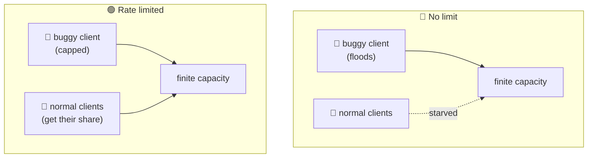
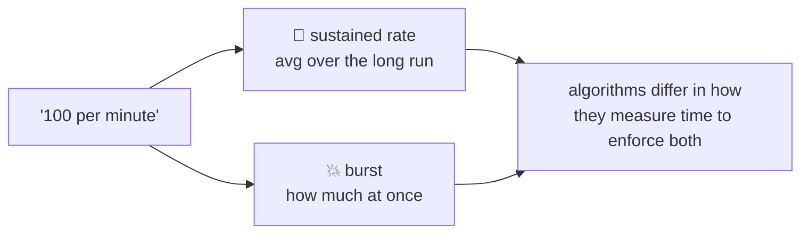
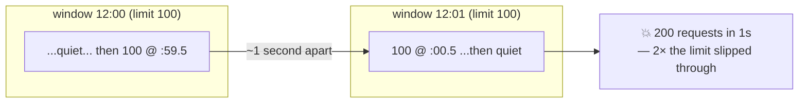
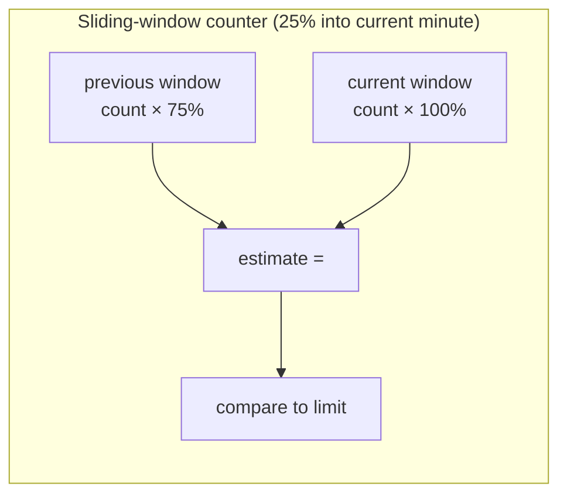
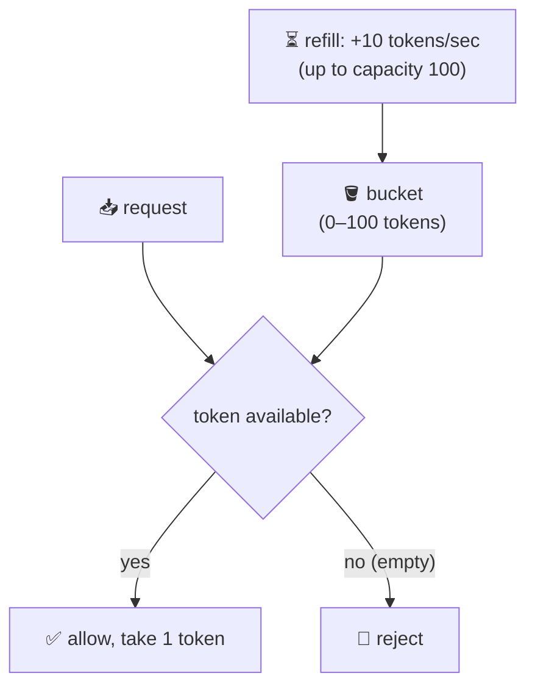
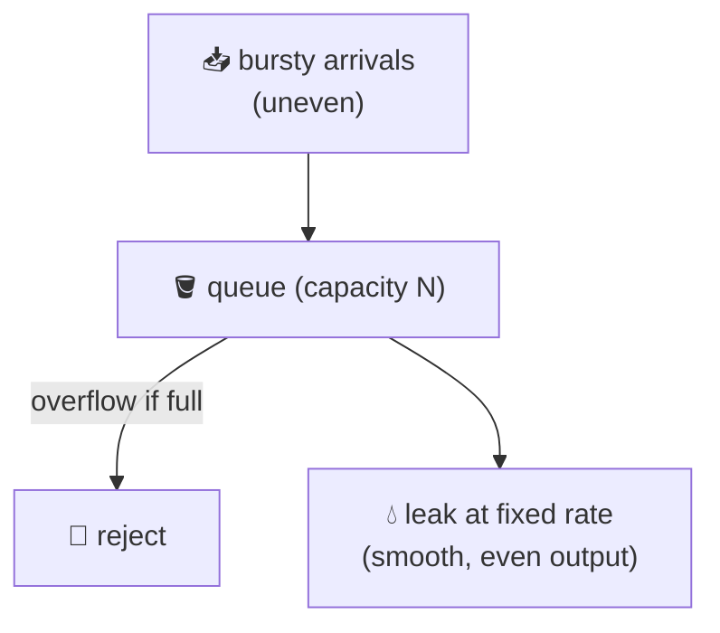
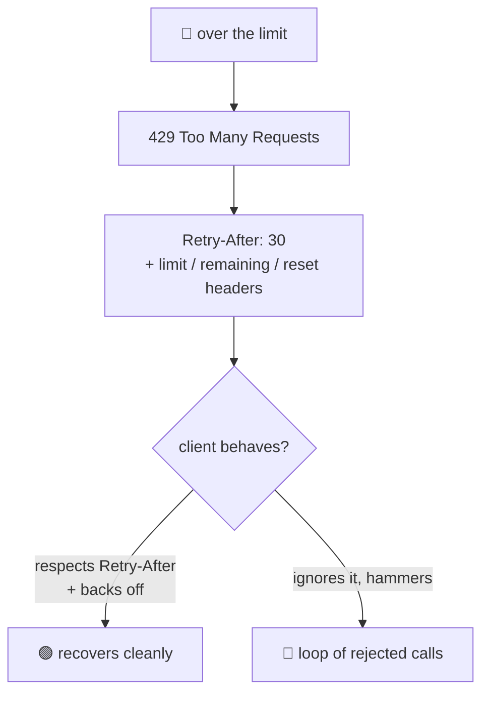
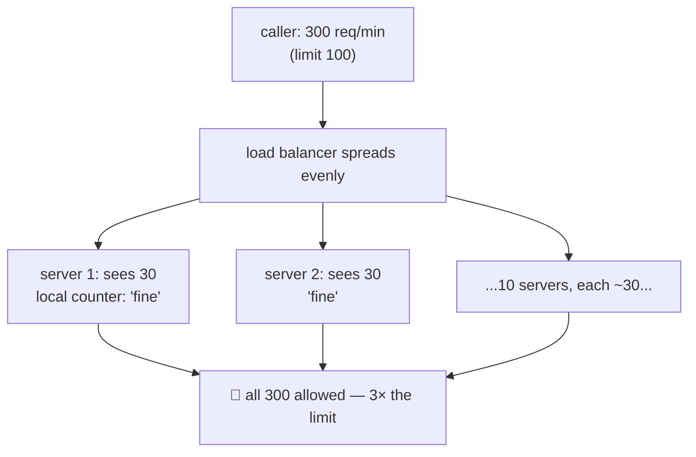

# Rate Limiting

> **Phase:** APIs & Communication Deep Dives → **Topic:** 12 of 15 → **Read time:** ~48 minutes

---

## Before You Begin

**This document stands alone.** It assumes you have read nothing else — not the foundation series, not the topics before it. It builds rate limiting from zero: why a shared resource has to protect itself from any single caller, what a "rate" even means once you look closely, the handful of algorithms that enforce one and how they differ, what to do with the requests you turn away, and the genuinely hard part — enforcing a single limit across a whole fleet of machines at once.

Two consequences of that choice:

- **Terms get defined where they're used** — rate, burst, fixed window, sliding window, token bucket, leaky bucket, `429`, fail-open. Skim what you know.
- **Neighbouring topics are named, not taught.** Rate limiting is often *performed* at a single front door (an API gateway) and is easily confused with its cousins (load shedding, backpressure, autoscaling). Where this document reaches them it names them and their destination, so it can stay on what's genuinely rate limiting's own.

Rate limiting appears in the **Top 30 Must-Know Concepts** foundation series. This is the deep-dive on how it actually works.

Here is the question the document answers:

> **A service has finite capacity, and it's shared by everyone who calls it — so one client that calls too much, whether by a bug, a scraper, or an attack, can consume the capacity meant for everyone else. How do you decide, for each individual request in the instant it arrives, whether a caller has already had more than its fair share — and why is that decision so much subtler than "count the requests and block over a number"?**

Here's the trap it disarms. Rate limiting looks like the simplest thing in this phase: keep a counter per caller, and when it passes a limit, start rejecting. That picture hides the whole subject. A raw count means nothing until you say *over what span of time* — and the instant you pin that down, you're forced into real choices. Do you allow the short bursts that real users legitimately make, or reject them? Can an attacker slip through at the edge of your time window? How much memory does tracking every caller cost? And when your limiter isn't one machine but fifty, how do they agree on a single count without talking to each other on every request? "A counter with a cap" answers none of these; the algorithms exist because each answers them differently.

> **The mindset shift:** stop thinking of a rate limit as *a counter that trips at a number* and start thinking of it as **a policy about how many requests are allowed per unit of time, for each caller** — where the unit of time is the hidden variable everything hard flows from. Once you see that a limit is fundamentally a statement about *time*, the rest of the subject falls into place: each algorithm is a different way of measuring time, the burst question is about how forgiving that measurement is, and the distributed problem is about many clocks and counters trying to agree. And underneath it all is one real job — telling a legitimate burst apart from sustained abuse — which is, again, a question about time.

---

## Table of Contents

1. [Why Limit — Protecting a Shared Resource](#1-why-limit--protecting-a-shared-resource)
2. [A Rate Is a Statement About Time](#2-a-rate-is-a-statement-about-time)
3. [Fixed Window — The Simple Counter and Its Flaw](#3-fixed-window--the-simple-counter-and-its-flaw)
4. [Sliding Window — Smoothing the Boundary](#4-sliding-window--smoothing-the-boundary)
5. [Token Bucket — Rate and Burst, Separated](#5-token-bucket--rate-and-burst-separated)
6. [Leaky Bucket — Smoothing the Output](#6-leaky-bucket--smoothing-the-output)
7. [What Happens When You Say No](#7-what-happens-when-you-say-no)
8. [Limiting Across Many Machines](#8-limiting-across-many-machines)
9. [Designing a Real Policy — and What It Isn't](#9-designing-a-real-policy--and-what-it-isnt)
10. [Putting It All Together — A Public API Platform](#10-putting-it-all-together--a-public-api-platform)
11. [Final Recap](#11-final-recap)

---

## 1. Why Limit — Protecting a Shared Resource

Before any algorithm, understand the problem rate limiting exists to solve, because the whole design follows from it. The problem is a consequence of one fact: a service has finite capacity, and that capacity is *shared*.

### One Caller Can Consume Everyone's Share

A running service can only do so much at once — so many requests per second, so much CPU, so many database connections, so much of a paid downstream it's billed for. That capacity is a common pool drawn from by every caller. And a common pool has a failure mode: **nothing stops a single caller from taking all of it.** When one client sends far more than its share, the pool empties, and *every other caller* is starved — slow responses, timeouts, errors — not because they did anything wrong, but because someone else drank the well dry. This is the "noisy neighbour," and it doesn't require malice to happen.

The excess traffic comes from several directions, and a system has to survive all of them:

- **A bug.** A client stuck in a loop, or a retry with no backoff, hammers the service thousands of times a second by accident. (Ironically, naive retries turn one struggling service into a self-inflicted flood.)
- **A scraper or greedy integrator.** A caller pulling far more data, far faster, than intended — not attacking, just inconsiderate.
- **An attack.** A deliberate flood meant to exhaust capacity and deny service to everyone else, or a credential-stuffing script trying millions of logins.
- **Runaway cost.** Even if capacity holds, each call may cost real money (a metered downstream, compute, bandwidth); unbounded calls mean an unbounded bill.

### The Limit Is a Fairness and Safety Boundary

Rate limiting is the mechanism that says: **no single caller may consume more than its allotted share of the pool.** That one rule buys three things at once:

- **Fairness** — capacity is divided among callers so one can't starve the rest.
- **Protection** — the service is shielded from being overwhelmed, whether by accident or attack, so it stays up for everyone.
- **Cost control** — usage has a ceiling, so a bug or an abuser can't run up an unbounded bill.

### It's Not the Same as Load Shedding

One distinction to draw at the outset, because the two get conflated. Rate limiting is about **per-caller fairness**: each *individual* caller is held to its own share, all the time, whether or not the system is under stress. A related but different technique, **load shedding**, is about **system-wide survival**: when the whole system is overloaded regardless of who's responsible, it starts dropping *some* work — often the least important — to stay alive. Rate limiting asks "has *this caller* had its share?"; load shedding asks "is *the system as a whole* drowning?" They complement each other and often run together, but they answer different questions, and load shedding is its own subject in a later phase. This document is about the per-caller question.

> 💡 **Key Insight**
>
> A service's capacity is **finite and shared**, and a shared pool has one fatal flaw: nothing inherently stops a single caller from draining it and starving everyone else — by bug, by greed, or by attack. Rate limiting is the rule that no caller may take more than its share, and it buys **fairness** (one client can't starve the rest), **protection** (the service survives floods, accidental or hostile), and **cost control** (usage has a ceiling). It is distinct from **load shedding**, which drops work to save an overloaded *system* regardless of who caused it — rate limiting asks whether *this caller* has had its share, not whether the whole system is drowning.

### Quick Recap — Why Limit

- A service's capacity is **finite and shared**, so without a limit a single caller — buggy, greedy, or hostile — can consume it all and **starve everyone else** (the noisy neighbour).
- Excess traffic comes from **bugs, scrapers, attacks, and runaway cost**, and a system must survive all of them, not just the malicious ones.
- Rate limiting caps each caller's share, buying **fairness, protection, and cost control** in a single rule.
- It is **not load shedding**: rate limiting enforces *per-caller* fairness always, while load shedding drops work to save an *overloaded system* — different questions, often used together.

---

## 2. A Rate Is a Statement About Time

Everyone writes limits like "100 requests per minute" and imagines the meaning is obvious. It isn't — and seeing exactly *why* it's ambiguous is the key that unlocks every algorithm in this document. The ambiguity is about time, and resolving it is the whole game.

### "100 Per Minute" Doesn't Say What You Think

Take "100 requests per minute" literally and ask: *which* minute? Two very different behaviours both satisfy the phrase:

- A caller sends 100 requests spread evenly — a bit under two per second, all minute long. Clearly fine.
- A caller sends all 100 in the first half-second and nothing for the rest of the minute. Also "100 per minute" — but it just hit the service with a spike 100× denser than the first caller.

Both obey the same words and stress the system completely differently. The phrase "100 per minute" fixes a *count* but leaves the *shape over time* undefined — and the shape is what actually determines whether the service can cope. A limit isn't real until you decide how you measure the passage of that minute, and that decision is precisely what separates one algorithm from another. **Every rate-limiting algorithm is a different answer to "how do we measure the time in 'per minute'?"**

### Two Things a Limit Really Encodes: Rate and Burst

The example reveals that a good limit has to control *two* separate quantities, not one:

- **The sustained rate** — how fast a caller may go *on average, over the long run*. This protects the steady-state capacity: 100/minute means that, held up over many minutes, a caller averages no more than that.
- **The burst** — how much a caller may do *in a short spike* before the average catches up. Real traffic is bursty: a user opens an app and it fires ten requests at once, then goes quiet. A limit that forbids all bursts would reject normal behaviour; a limit that allows unlimited bursts protects nothing.

The art is allowing a *reasonable* burst while holding the *sustained* rate — and the algorithms differ mainly in how cleanly they let you express those two knobs. The ones that conflate them (a single window) are cruder; the one that separates them explicitly (the token bucket) is why it's the default.

### A Limit Is Always Per-Something

One more thing every limit needs before it means anything: a **key** — the *per-what*. You never limit "requests" in the abstract; you limit requests *per caller*, and you must choose what "caller" means:

- **Per user or per account** — fair across people, and the usual choice for a logged-in product.
- **Per API key** — the standard for a public API, where a key identifies the integrator (and often their paid tier).
- **Per IP address** — the fallback when there's no identity yet (an anonymous or login endpoint), though imperfect: many users can share one IP (behind a corporate network), and one attacker can spread across many IPs.

The key is half the policy, because it decides *what gets its own share*. A limit keyed on IP protects differently from one keyed on account, and choosing the wrong key can either punish innocents (many users behind one IP) or fail to contain an abuser (one account, many IPs). Identifying the caller reliably is an authentication concern of its own; here the point is that a rate limit is always *rate per key per unit of time* — three parts, and the sections that follow are about the third.

> 💡 **Key Insight**
>
> "100 per minute" is ambiguous because it fixes a **count** but not the **shape over time** — 100 spread evenly and 100 in a half-second both satisfy it while stressing the service utterly differently. So a real limit must control **two** things: a **sustained rate** (the long-run average) and a **burst** (how much at once), because real traffic is bursty and both "no bursts" and "unlimited bursts" are wrong. And a limit is always **per a key** — per user, per API key, per IP — which decides *what gets its own share* and is half the policy. Every algorithm ahead is a different way of measuring time to enforce rate-and-burst, per key.

### Quick Recap — A Rate Is About Time

- "100 per minute" fixes a **count** but not the **shape over time**; 100 evenly and 100 in a half-second both satisfy it yet stress the service completely differently.
- A real limit controls **two** things: a **sustained rate** (long-run average) and a **burst** (how much at once) — since real traffic is bursty, both forbidding and unbounding bursts are wrong.
- A limit is always **per a key** (user, API key, or IP) — the *per-what* decides what gets its own share and is half the policy; IP is the imperfect fallback when there's no identity.
- **Every algorithm is a different answer to "how do we measure the time"** in a rate — which is why choosing one is choosing how you treat bursts and boundaries.

---

## 3. Fixed Window — The Simple Counter and Its Flaw

The most obvious way to measure "per minute" is to chop time into fixed minute-long blocks by the clock and count within each. This is the **fixed-window** algorithm, and it's worth studying precisely because it's the one people invent by default — and because its one flaw teaches what all the later algorithms are fixing.

### How It Works

Divide time into fixed windows aligned to the clock — say, each calendar minute (12:00:00–12:00:59, then 12:01:00–12:01:59, and so on). For each key, keep one **counter** for the current window. Every request increments it; if the counter is at or below the limit, allow the request; if it's over, reject. When the clock ticks into the next window, the counter **resets to zero.**

That's the entire algorithm, and its appeal is obvious: it's almost nothing to build. One integer per caller, an increment, a compare, and a reset on the minute. It's cheap in memory (a single number per key) and trivially fast. For many low-stakes limits it's perfectly adequate, and its simplicity is a real virtue.

### The Boundary Burst

The flaw is subtle and shows up exactly at the seam between windows. Because the counter resets abruptly at the window boundary, a caller can spend its *entire* allowance at the very end of one window and its *entire* allowance again at the very start of the next — and those two bursts are only a moment apart.

Concretely, with a limit of 100 per minute: a caller sends 100 requests at 12:00:59.5, then 100 more at 12:01:00.5. Each window's counter saw only 100, so nothing was rejected — but the service just took **200 requests in one second**, twice the limit, in the span that straddles the boundary. Over any *aligned* minute the rule held; over the *real* 60-second window around the boundary, the caller did double.

This isn't a rare corner case an attacker has to work for — it's a predictable doubling available at every boundary, and a caller aiming to maximize throughput will simply align to it. The root cause is that the fixed window has **no memory across the reset**: the moment the clock ticks, it forgets everything that just happened, so the burst on one side is invisible to the other.

### What It Teaches

The fixed window fails because it measures time in *abrupt, aligned chunks* and resets with a hard edge. Everything that follows is a way of softening that edge — remembering across the boundary (the sliding window, §4) or replacing the "reset" with a smooth, continuous refill (the token bucket, §5). Hold onto the flaw: it's the concrete problem the next two sections exist to solve.

> ⚠️ **The fixed window is the cheapest algorithm and the one with the trap everyone hits: because its counter resets abruptly at each clock boundary, it has no memory across the reset — so a caller can spend a full allowance just before the boundary and a full allowance just after, pushing 2× the limit through in a moment while every aligned window still reads "within limit."** It's fine for loose, low-stakes limits where a transient double doesn't matter, but it does not truly hold a rate. The later algorithms are, at heart, ways of removing that hard edge.

### Quick Recap — Fixed Window

- **Fixed window** chops time into clock-aligned blocks (e.g. each minute), keeps **one counter per key**, allows up to the limit, and **resets to zero** at each boundary.
- It's the **cheapest** algorithm — one integer per caller, an increment and a compare — and adequate for loose, low-stakes limits.
- Its flaw is the **boundary burst**: with no memory across the reset, a caller can spend a full allowance just before *and* just after a boundary, pushing **up to 2× the limit** through in an instant.
- The lesson driving the rest of the topic: a hard, aligned reset doesn't truly hold a rate — later algorithms **soften the edge** by remembering across it or refilling smoothly.

---

## 4. Sliding Window — Smoothing the Boundary

The fixed window's flaw (§3) was the hard reset: it measures a *clock-aligned* minute and forgets everything at the boundary. The **sliding-window** family fixes this by measuring the minute *relative to now* — always looking back over the last 60 seconds from the current instant, so there's no boundary to exploit. There are two ways to do it, trading accuracy against cost.

### Sliding-Window Log — Exact, but Heavy

The precise version keeps, for each key, a **log of the timestamp of every request**. To decide a new request, you count how many timestamps fall within the last window (say, the last 60 seconds), discard any older than that, and allow the request only if the count is under the limit.

This is exactly correct: the window truly slides with each request, so there's no boundary to game — 100 in any rolling 60-second span is 100, full stop. The cost is the log: you store a timestamp for *every* request from *every* caller within the window, and busy callers mean large logs and real memory and processing per request. It's accurate but it scales poorly, which is why it's often not what runs in production at high volume.

### Sliding-Window Counter — A Cheap, Good-Enough Approximation

The practical version keeps the fixed window's cheapness but borrows just enough from the previous window to smooth the seam. You keep two counters — the **current** window's and the **previous** window's — and estimate the rolling count by *weighting* the previous window by how much of it still overlaps the rolling window.

Concretely: if you're 25% of the way into the current minute, then the last 60 seconds is 25% of the current window plus the last 75% of the previous one. So the estimate is `current_count + previous_count × 75%`. As the current window fills, the previous window's weight fades smoothly toward zero. That single weighted number approximates the true rolling count closely, kills the boundary burst (the previous window's requests still count, weighted, just after the reset), and costs only *two* integers per key instead of a full log.

The approximation assumes traffic within a window is spread evenly, so it can be slightly off under very lumpy traffic — but in practice it's close enough that the sliding-window counter is one of the most widely used real-world algorithms: nearly as cheap as a fixed window, without the boundary hole.

### The Tradeoff It Illustrates

The two variants bracket a tradeoff you'll see throughout: **accuracy costs state.** The log is exact and expensive; the counter is approximate and cheap. Most systems choose the cheap approximation because "very close, for two integers" beats "exact, for an unbounded log" at scale — a recurring theme in rate limiting, where good-enough-and-cheap usually wins over perfect-and-heavy.

> 💡 **Key Insight**
>
> The sliding window fixes the fixed window's boundary burst by measuring the last N seconds **relative to now** rather than in clock-aligned chunks, so there's no seam to exploit. The **log** variant stores every request's timestamp — exactly correct but memory-heavy, scaling with traffic. The **counter** variant keeps just the current and previous window counts and **weights the previous one by its remaining overlap** (`current + previous × overlap%`) — killing the boundary burst for the cost of two integers, at the price of a mild even-traffic assumption. It illustrates the recurring rate-limiting tradeoff: **accuracy costs state**, and the cheap approximation usually wins.

### Quick Recap — Sliding Window

- The sliding window measures the last N seconds **relative to now**, not in clock-aligned blocks, so the §3 boundary burst has no seam to exploit.
- The **log** variant stores every request's timestamp — **exactly correct but memory-heavy**, scaling with traffic per caller.
- The **counter** variant weights the previous window by its remaining overlap (`current + previous × overlap%`) — **cheap (two integers) and close enough**, and one of the most widely used real algorithms.
- It illustrates the recurring tradeoff — **accuracy costs state** — and most systems pick the cheap approximation over the exact, heavy log.

---

## 5. Token Bucket — Rate and Burst, Separated

The window algorithms all measure time by counting requests *within a span*. The **token bucket** takes a different, more elegant angle: instead of counting what's happened, it tracks how much *allowance* a caller has accumulated. This reframing is why it's the most widely used rate-limiting algorithm — it maps directly onto the rate-and-burst distinction from §2.

### How It Works

Picture a bucket that holds **tokens**. Two numbers define it:

- The bucket has a maximum **capacity** — say, 100 tokens.
- Tokens are added at a steady **refill rate** — say, 10 per second — until the bucket is full (extra refill past capacity is simply discarded).

Each incoming request must **take one token** to proceed. If a token is available, the request is allowed and the bucket drops by one. If the bucket is **empty**, there's no token to take, and the request is rejected. That's the whole mechanism: refill steadily, spend one per request, reject when empty.

### Why the Two Knobs Are the Whole Point

The elegance is that the bucket's two numbers *are* the two things a limit must control (§2), cleanly separated:

- **The refill rate is the sustained rate.** Over the long run, a caller can't spend faster than tokens are added — 10/sec refill means a sustained ceiling of 10 requests per second, no matter what. The average is enforced by the refill.
- **The bucket capacity is the burst allowance.** A caller who's been quiet lets tokens accumulate up to the full 100; then it can fire 100 requests *at once*, draining the bucket in an instant. That's a burst of 100 — but immediately afterward the bucket is empty and the caller is throttled back to the 10/sec refill until it recovers. So the capacity sets exactly how big a one-time burst is tolerated, independently of the sustained rate.

This is exactly the shape of real traffic from §2: a client that's idle and then spikes is *allowed* to spike (up to the bucket size), while a client trying to sustain an abusive rate is held to the refill. You tune "how bursty may they be" and "how fast may they go long-term" as two separate dials — which no single-window algorithm lets you do. That direct match to the rate-and-burst reality is why the token bucket is the default choice.

### Why It Has No Boundary Flaw

Notice the token bucket has no windows and no resets, so the §3 boundary burst simply can't occur. Allowance isn't handed out in aligned chunks that reset; it accrues *continuously* and is spent continuously. There's no seam in time to straddle, because time is never divided — the bucket just fills smoothly and drains as requests come. The "reset" that plagued the fixed window is replaced by a gradual, ever-present refill, which is a fundamentally smoother way to measure a rate.

> 💡 **Key Insight**
>
> The **token bucket** tracks accumulated *allowance* rather than counting requests in a span: tokens refill at a steady rate up to a capacity, each request spends one, and an empty bucket rejects. Its power is that its two numbers *are* §2's two knobs, cleanly separated — the **refill rate is the sustained ceiling** (you can't spend faster than tokens arrive long-term) and the **capacity is the burst** (an idle caller banks tokens and can spike that many at once, then falls back to the refill). That's exactly the shape of real traffic — idle then bursty — so it's the default algorithm. And because allowance accrues continuously with no window to reset, it has **no boundary burst** at all.

### Quick Recap — Token Bucket

- A **token bucket** refills tokens at a steady **rate** up to a **capacity**; each request spends one token, and an **empty bucket rejects** — it tracks *allowance*, not a count in a span.
- Its two numbers are §2's two knobs, cleanly separated: **refill rate = sustained ceiling**, **capacity = burst size** — tunable independently.
- This matches real traffic (idle, then a spike): an idle caller banks tokens and may **burst up to capacity**, then is throttled to the refill — which is why it's the **default** algorithm.
- Because allowance accrues **continuously** with no window reset, it has **no boundary burst** — the smooth refill replaces the fixed window's hard edge.

---

## 6. Leaky Bucket — Smoothing the Output

The token bucket's sibling is the **leaky bucket**, and the two are so often confused it's worth pinning down precisely how they differ. Both use a bucket; both bound a rate. But they answer different questions: the token bucket asks "may this request *go through now*?" while the leaky bucket asks "at what steady pace do requests *leave*?" The difference is whether you're controlling the *input* or shaping the *output*.

### How It Works

Picture a bucket with a hole in the bottom that **leaks at a fixed rate.** Incoming requests are water poured in from the top: they enter a queue (the bucket) and drain out the bottom at a constant pace — say, exactly 10 per second, no matter how they arrived. If requests pour in faster than the leak for long enough, the bucket **fills to capacity and overflows**, and overflowing requests are rejected.

The defining property is the *output*: whatever the arrival pattern — a smooth trickle or a violent spike — requests leave the bucket at a perfectly steady rate. The bucket absorbs burstiness on the way in and emits a smooth stream on the way out.

### Token Bucket vs Leaky Bucket

The contrast is the whole point, and it's about what happens to a burst:

| | Token bucket | Leaky bucket |
|---|---|---|
| Controls | Whether a request is **admitted** now | The **rate requests leave** |
| A burst is… | **Let through** (up to bucket capacity), then throttled | **Smoothed** — queued and released at the steady rate |
| Output shape | Bursty (mirrors admitted input) | Always steady |
| Good when | The backend *tolerates* bursts and you want responsiveness | The backend needs a *smooth, capped* input rate |

A token bucket *permits* a burst to reach the backend — good when the backend can absorb a spike and you'd rather serve the caller's burst immediately. A leaky bucket *refuses to pass a burst through* — it holds requests and releases them evenly, good when whatever's downstream must never receive more than a fixed rate (a fragile legacy system, a strictly metered third party). One optimizes for letting legitimate bursts through; the other for protecting a downstream that can't handle bursts at all.

### A Note on the Confusion

The two get muddled because you can describe similar behaviour from either framing, and some systems label a queue-based limiter a "leaky bucket" and an allowance-based one a "token bucket" while achieving overlapping goals. The reliable way to keep them straight is by the *question each answers*: token bucket controls **admission** (is there allowance to go now?), leaky bucket controls **emission** (requests leave at a fixed drip). If your goal is "let callers burst up to a point," reach for the token bucket; if it's "guarantee the thing downstream never sees more than X per second," reach for the leaky bucket.

> 💡 **Key Insight**
>
> The **leaky bucket** queues requests and drains them at a **fixed output rate**, overflowing (rejecting) when full — so no matter how bursty the arrivals, the *output* is always smooth. That's the exact inverse of the token bucket's behaviour on a burst: the token bucket **lets a burst through** (up to capacity) then throttles, while the leaky bucket **absorbs the burst** and releases it evenly. Keep them straight by the question each answers — token bucket controls **admission** ("is there allowance now?"), leaky bucket controls **emission** ("requests leave at a steady drip"). Choose token bucket to allow legitimate bursts to a burst-tolerant backend; choose leaky bucket to guarantee a fragile downstream never sees more than a fixed rate.

### Quick Recap — Leaky Bucket

- A **leaky bucket** queues arrivals and drains them at a **fixed rate**, overflowing (rejecting) when full — so the **output is always smooth** regardless of how bursty the input.
- It's the inverse of the token bucket on a burst: token bucket **lets bursts through** then throttles; leaky bucket **smooths bursts** into a steady stream.
- Keep them straight by the question: token bucket controls **admission** ("allowance to go now?"), leaky bucket controls **emission** ("steady drip out").
- Choose **token bucket** to allow legitimate bursts to a burst-tolerant backend; choose **leaky bucket** to protect a downstream that must never exceed a fixed input rate.

---

## 7. What Happens When You Say No

Every algorithm so far decides *whether* to allow a request. This section is about the other half, which teams routinely neglect: what you actually *do* with a request you've decided to reject. A rejection is part of your API's contract too, and doing it badly turns a protective limit into a source of chaos.

### Reject, Throttle, or Degrade

"Over the limit" doesn't have to mean a hard rejection. There are three responses, suited to different situations:

- **Reject** — refuse the request immediately and cheaply, telling the caller to try later. This is the default for a public API: fail fast, use almost no resources on the rejected call, and let the caller decide when to retry. The whole point of a limit is protection, and the cheapest protection is a fast "no."
- **Throttle (delay/queue)** — instead of refusing, *hold* the request and release it when capacity is available (this is the leaky-bucket shape from §6). This smooths traffic without errors, but it isn't free: queued requests consume memory and add latency, and an unbounded queue is its own way to fall over. Use it when a short delay is preferable to an error and the backlog is bounded.
- **Degrade** — serve a cheaper substitute instead of the full response: a cached or stale result, a partial answer, a lower-fidelity version. The caller gets *something* useful while the expensive path is protected. This is often the best user experience when a real answer is too costly right now.

### Say No Clearly: `429` and `Retry-After`

However you reject, *how you communicate it* matters enormously, because the caller has to react. The convention is precise and worth following exactly:

- Respond with **`429 Too Many Requests`** — the standard status that unambiguously says "you were rate-limited," distinct from other errors so clients and monitoring can treat it specifically.
- Include a **`Retry-After`** header telling the caller *when* it's worth trying again (a number of seconds, or a timestamp). This turns a blind "no" into an actionable "no, wait this long."
- Optionally expose the policy via headers — the limit, how many requests remain, and when the window resets — so a well-behaved caller can *pace itself* and never hit the wall in the first place.

A rejection that says only "error" invites the worst outcome: the caller retries immediately and repeatedly, turning your protective limit into a tight loop of rejected requests that still costs you to process. A clear `429` with `Retry-After` is what lets the caller behave.

### The Rejection Is a Two-Sided Contract

A limit only works if the caller cooperates, so the client has a duty that mirrors the server's. A well-behaved client **respects `Retry-After`**, and when it must retry on its own, it uses **exponential backoff with jitter** — waiting progressively longer and staggering its attempts — rather than retrying instantly and in lockstep, which would just reproduce the flood the limit exists to stop. (This retry discipline is the same one any robust client uses against transient failures; here it's the specific, cooperative response to a `429`.) The server's job is to reject cheaply and inform clearly; the client's job is to slow down when told. When both hold, a rate limit is a smooth negotiation; when the client ignores the signal, even a correct limit degrades into wasted work on both sides.

> ⚠️ **A limit is only half-built until you've designed the rejection — and a bad rejection can cost as much as no limit.** Choose the response to fit the case: **reject** (fail fast and cheap, the public-API default), **throttle** (queue and release, smoothing without errors but adding latency and a bounded backlog), or **degrade** (serve a cheaper/stale substitute). Communicate it precisely — **`429 Too Many Requests`** with **`Retry-After`**, ideally plus limit/remaining/reset headers so callers self-pace. And it's a two-sided contract: the client must **respect `Retry-After` and back off with jitter**, or a correct limit collapses into a loop of rejected calls that still burns resources on both ends.

### Quick Recap — When You Say No

- "Over the limit" has three responses: **reject** (fast, cheap — the public default), **throttle** (queue and release, smoothing at the cost of latency and a bounded backlog), or **degrade** (a cheaper/stale substitute).
- Communicate rejection with **`429 Too Many Requests`** and **`Retry-After`**, so a blind "no" becomes an actionable "no, wait this long."
- Optionally expose **limit / remaining / reset** headers so well-behaved callers **pace themselves** and never hit the wall.
- It's a **two-sided contract**: the client must respect `Retry-After` and **back off with jitter**, or a correct limit degrades into a costly loop of rejected requests.

---

## 8. Limiting Across Many Machines

Everything so far quietly assumed one limiter with one view of a caller's traffic. Real systems don't have that. To handle load and stay available, the tier that enforces limits — the fleet of front-door servers all traffic flows through — is itself *many* machines, and a caller's requests are spread across them. This turns a solved single-machine problem back into a hard one, and it's where rate limiting gets genuinely deep.

### Why One Limit Across Many Limiters Is Hard

Suppose the limit is 100 requests per minute for a caller, and there are 10 front-door servers behind a load balancer. A caller's 300 requests get spread roughly evenly — about 30 to each server. Now ask each server, using its *own* local counter: "has this caller exceeded 100?" Every server sees only ~30 and answers "no, well under." So all 300 are allowed — **triple the limit** — even though not one server did anything wrong. Each was correct about what it saw; none saw the whole picture.

The general failure: with purely local counters, a caller can exceed the true limit by up to a **factor of the fleet size**. Ten servers can let through 10× the limit; a hundred, 100×. The more you scale the limiter for availability, the *weaker* a local limit becomes. So the enforcement tier needs some way for its members to share a single, global view of each caller's usage — and sharing state across machines, cheaply and fast enough to check on every request, is the crux.

### The Two Ends of the Tradeoff

There are two basic approaches, and they sit at opposite ends of an accuracy-versus-cost spectrum:

- **A shared central counter.** All limiter instances read and update one shared store (a fast in-memory data store the whole fleet talks to) that holds each caller's count. This is **accurate** — everyone consults the same global number — but it has costs: every request now makes a network call to the shared store (added latency), the store becomes a **dependency** the limiter can't work without, and a very active caller's counter becomes a **hot key** that concentrates load on one spot in the store. The mechanics of running such a shared store belong to later material; the point here is the tradeoff it buys: correctness, paid for in latency and a dependency.
- **Local approximate limits.** Each instance limits independently against a *share* of the global limit (e.g. each of 10 servers enforces 10/minute locally for a 100/minute global cap), or enforces the full limit locally and tolerates the overage. This is **fast** — no coordination, no shared dependency, every check is local — but **loose**: uneven traffic across servers means the real global limit is only approximated, sometimes under-, sometimes over-enforced.

### Living in the Middle

Most real systems land between the extremes, trading a little accuracy for a lot less coordination:

- **Sync periodically.** Instances keep fast local counters and reconcile with a shared store every so often (every few seconds) rather than on every request — bounding the error without paying the shared-store cost per call.
- **Route a caller to a consistent instance.** If all of one caller's traffic reliably lands on the *same* limiter instance, that instance sees the caller's whole picture and a local counter becomes accurate again — pushing the coordination problem into how traffic is routed instead.

The honest summary: perfectly accurate distributed rate limiting is expensive, and most systems accept **approximate** enforcement because "within a small margin of the limit, cheaply" beats "exactly the limit, slowly" — the same accuracy-costs-state tradeoff from §4, now at fleet scale. A limit that's occasionally 10% loose but adds no latency is usually the better engineering choice than one that's exact but puts a network round trip and a shared dependency on the critical path of every request.

> 💡 **Key Insight**
>
> A real limiter is **many machines**, and a caller's traffic spreads across them — so purely **local** counters let a caller exceed the true limit by up to the **fleet-size factor** (10 servers → 10× the limit), and scaling the limiter for availability makes a local limit *weaker*. The fix needs a shared view, and the choice is a spectrum: a **shared central counter** is accurate but adds latency, a dependency, and hot keys; **local approximate** limits are fast but loose. Most systems live in the middle — periodic sync, or routing a caller consistently to one instance — accepting **approximate** enforcement because within-a-margin-and-cheap beats exact-and-slow when the check is on every request's critical path.

### Quick Recap — Limiting Across Many Machines

- A real limiter is a **fleet**, and a caller's traffic spreads across it, so **local counters** let a caller exceed the limit by up to the **fleet-size factor** — scaling the limiter weakens a local limit.
- A **shared central counter** gives accuracy but costs **latency, a dependency, and hot keys** on very active callers; the shared-store mechanics are a later subject.
- **Local approximate** limits (a per-instance share, or tolerated overage) are fast and coordination-free but **loose** under uneven traffic.
- Most systems land in the **middle** — periodic sync or consistent per-caller routing — accepting **approximate** enforcement, because within-a-margin-and-cheap beats exact-and-slow on every request's critical path.

---
