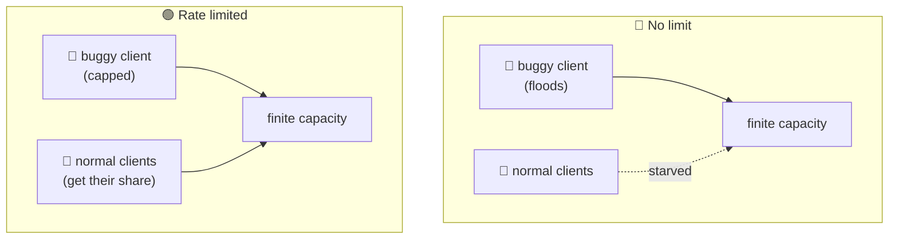

# Rate Limiting

> **Phase:** APIs & Communication Deep Dives → **Topic:** 12 of 15 → **Read time:** ~48 minutes

---

## Before You Begin

**This document stands alone.** It assumes you have read nothing else — not the foundation series, not the topics before it. It builds rate limiting from zero: why a shared resource has to protect itself from any single caller, what a "rate" even means once you look closely, the handful of algorithms that enforce one and how they differ, what to do with the requests you turn away, and the genuinely hard part — enforcing a single limit across a whole fleet of machines at once.

Two consequences of that choice:

- **Terms get defined where they're used** — rate, burst, fixed window, sliding window, token bucket, leaky bucket, `429`, fail-open. Skim what you know.
- **Neighbouring topics are named, not taught.** Rate limiting is often *performed* at a single front door (an API gateway) and is easily confused with its cousins (load shedding, backpressure, autoscaling). Where this document reaches them it names them and their destination, so it can stay on what's genuinely rate limiting's own.

Rate limiting appears in the **Top 30 Must-Know Concepts** foundation series. This is the deep-dive on how it actually works.

Here is the question the document answers:

> **A service has finite capacity, and it's shared by everyone who calls it — so one client that calls too much, whether by a bug, a scraper, or an attack, can consume the capacity meant for everyone else. How do you decide, for each individual request in the instant it arrives, whether a caller has already had more than its fair share — and why is that decision so much subtler than "count the requests and block over a number"?**

Here's the trap it disarms. Rate limiting looks like the simplest thing in this phase: keep a counter per caller, and when it passes a limit, start rejecting. That picture hides the whole subject. A raw count means nothing until you say *over what span of time* — and the instant you pin that down, you're forced into real choices. Do you allow the short bursts that real users legitimately make, or reject them? Can an attacker slip through at the edge of your time window? How much memory does tracking every caller cost? And when your limiter isn't one machine but fifty, how do they agree on a single count without talking to each other on every request? "A counter with a cap" answers none of these; the algorithms exist because each answers them differently.

> **The mindset shift:** stop thinking of a rate limit as *a counter that trips at a number* and start thinking of it as **a policy about how many requests are allowed per unit of time, for each caller** — where the unit of time is the hidden variable everything hard flows from. Once you see that a limit is fundamentally a statement about *time*, the rest of the subject falls into place: each algorithm is a different way of measuring time, the burst question is about how forgiving that measurement is, and the distributed problem is about many clocks and counters trying to agree. And underneath it all is one real job — telling a legitimate burst apart from sustained abuse — which is, again, a question about time.

---

## Table of Contents

1. [Why Limit — Protecting a Shared Resource](#1-why-limit--protecting-a-shared-resource)
2. [A Rate Is a Statement About Time](#2-a-rate-is-a-statement-about-time)
3. [Fixed Window — The Simple Counter and Its Flaw](#3-fixed-window--the-simple-counter-and-its-flaw)
4. [Sliding Window — Smoothing the Boundary](#4-sliding-window--smoothing-the-boundary)
5. [Token Bucket — Rate and Burst, Separated](#5-token-bucket--rate-and-burst-separated)
6. [Leaky Bucket — Smoothing the Output](#6-leaky-bucket--smoothing-the-output)
7. [What Happens When You Say No](#7-what-happens-when-you-say-no)
8. [Limiting Across Many Machines](#8-limiting-across-many-machines)
9. [Designing a Real Policy — and What It Isn't](#9-designing-a-real-policy--and-what-it-isnt)
10. [Putting It All Together — A Public API Platform](#10-putting-it-all-together--a-public-api-platform)
11. [Final Recap](#11-final-recap)

---

## 1. Why Limit — Protecting a Shared Resource

Before any algorithm, understand the problem rate limiting exists to solve, because the whole design follows from it. The problem is a consequence of one fact: a service has finite capacity, and that capacity is *shared*.

### One Caller Can Consume Everyone's Share

A running service can only do so much at once — so many requests per second, so much CPU, so many database connections, so much of a paid downstream it's billed for. That capacity is a common pool drawn from by every caller. And a common pool has a failure mode: **nothing stops a single caller from taking all of it.** When one client sends far more than its share, the pool empties, and *every other caller* is starved — slow responses, timeouts, errors — not because they did anything wrong, but because someone else drank the well dry. This is the "noisy neighbour," and it doesn't require malice to happen.

The excess traffic comes from several directions, and a system has to survive all of them:

- **A bug.** A client stuck in a loop, or a retry with no backoff, hammers the service thousands of times a second by accident. (Ironically, naive retries turn one struggling service into a self-inflicted flood.)
- **A scraper or greedy integrator.** A caller pulling far more data, far faster, than intended — not attacking, just inconsiderate.
- **An attack.** A deliberate flood meant to exhaust capacity and deny service to everyone else, or a credential-stuffing script trying millions of logins.
- **Runaway cost.** Even if capacity holds, each call may cost real money (a metered downstream, compute, bandwidth); unbounded calls mean an unbounded bill.

### The Limit Is a Fairness and Safety Boundary

Rate limiting is the mechanism that says: **no single caller may consume more than its allotted share of the pool.** That one rule buys three things at once:

- **Fairness** — capacity is divided among callers so one can't starve the rest.
- **Protection** — the service is shielded from being overwhelmed, whether by accident or attack, so it stays up for everyone.
- **Cost control** — usage has a ceiling, so a bug or an abuser can't run up an unbounded bill.

### It's Not the Same as Load Shedding

One distinction to draw at the outset, because the two get conflated. Rate limiting is about **per-caller fairness**: each *individual* caller is held to its own share, all the time, whether or not the system is under stress. A related but different technique, **load shedding**, is about **system-wide survival**: when the whole system is overloaded regardless of who's responsible, it starts dropping *some* work — often the least important — to stay alive. Rate limiting asks "has *this caller* had its share?"; load shedding asks "is *the system as a whole* drowning?" They complement each other and often run together, but they answer different questions, and load shedding is its own subject in a later phase. This document is about the per-caller question.

> 💡 **Key Insight**
>
> A service's capacity is **finite and shared**, and a shared pool has one fatal flaw: nothing inherently stops a single caller from draining it and starving everyone else — by bug, by greed, or by attack. Rate limiting is the rule that no caller may take more than its share, and it buys **fairness** (one client can't starve the rest), **protection** (the service survives floods, accidental or hostile), and **cost control** (usage has a ceiling). It is distinct from **load shedding**, which drops work to save an overloaded *system* regardless of who caused it — rate limiting asks whether *this caller* has had its share, not whether the whole system is drowning.

### Quick Recap — Why Limit

- A service's capacity is **finite and shared**, so without a limit a single caller — buggy, greedy, or hostile — can consume it all and **starve everyone else** (the noisy neighbour).
- Excess traffic comes from **bugs, scrapers, attacks, and runaway cost**, and a system must survive all of them, not just the malicious ones.
- Rate limiting caps each caller's share, buying **fairness, protection, and cost control** in a single rule.
- It is **not load shedding**: rate limiting enforces *per-caller* fairness always, while load shedding drops work to save an *overloaded system* — different questions, often used together.

---
